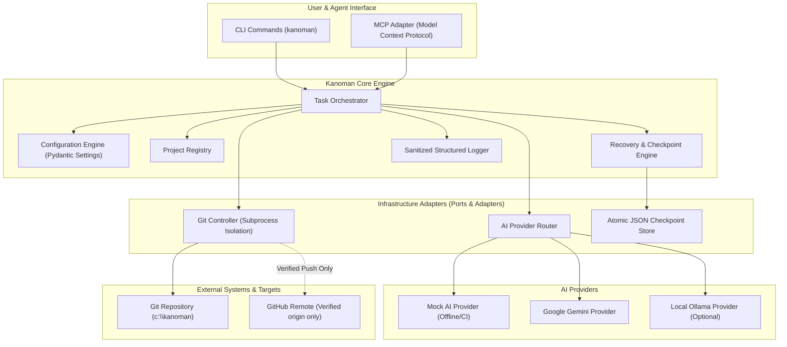

# Kanoman AI — Architecture Specification

**Status:** Definitive Architecture Baseline (Phase 1–6)  
**Versi:** 1.0.0  
**Arsitek:** Principal AI Systems & Security Architect  

---

## 1. Ikhtisar Arsitektur

Kanoman AI dirancang menggunakan **Hexagonal Architecture (Ports and Adapters)** yang memisahkan logika orkestrasi bisnis inti (*Kanoman Core*) dari mekanisme eksternal seperti Provider AI, Git Version Control, Filesystem Storage, dan Antarmuka Pengguna (CLI / MCP).

---

## 2. Lapisan Modul & Tanggung Jawab

### A. Core Engine (`src/kanoman/core/`)
- **Domain Models (`models.py`):**
  - `Task`: Merepresentasikan unit kerja dengan ID unik, deskripsi, status (`PENDING`, `RUNNING`, `COMPLETED`, `FAILED`, `CANCELLED`), hasil sanitasi, dan timestamp.
  - `Project`: Registrasi proyek target dengan workspace root, branch kebijakan, remote URL yang diizinkan, dan batas operasi Git.
  - `Checkpoint`: Snapshot keadaan task dan repositori pada suatu titik waktu untuk auditabilitas dan pemulihan (recovery).
- **Orchestrator (`orchestrator.py`):**
  - Menerima task, memvalidasi input, memilih handler, mengeksekusi proses, mencatat log terstruktur, dan membuat checkpoint otomatis.

### B. Configuration Engine (`src/kanoman/config/`)
- Menggunakan Pydantic Settings untuk memuat konfigurasi dari variabel lingkungan atau file `.env`.
- Menegakkan nilai default yang aman (fail-closed, dry-run by default untuk Git operations jika tidak ditentukan).
- Menyembunyikan token dan credential rahasia dari log maupun representasi string (`SecretStr`).

### C. Git Controller (`src/kanoman/git/`)
- Menjadi **satu-satunya titik masuk** untuk seluruh operasi Git otomatis.
- Menjalankan 4 mode operasi yang tegas: `inspect`, `dry-run`, `commit`, dan `push`.
- Memverifikasi root repository, URL remote yang diizinkan, dan branch aktif sebelum eksekusi apa pun.
- Melarang keras `git reset --hard` dan force push.
- Memindai staged changes untuk mencegah kebocoran secret atau file yang tidak sengaja terbawa.

### D. AI Abstraction Layer (`src/kanoman/ai/`)
- `AIProviderProtocol`: Kontrak antarmuka abstrak (`generate_text`, `health_check`, `get_capabilities`).
- `MockAIProvider`: Implementasi bawaan untuk pengujian unit 100% offline tanpa internet atau API key.
- `GeminiProvider`: Adapter REST/SDK ringan untuk Google Gemini AI API.
- `OllamaProvider`: Adapter lokal opsional untuk inference mandiri.
- `ProviderRouter`: Menangani fallback cerdas dan pencatatan penggunaan token.

### E. Recovery Engine (`src/kanoman/checkpoints/`)
- Menyimpan snapshot status task dan checkpoint ke direktori `.kanoman_checkpoints/`.
- Menerapkan penulisan file secara atomik (*atomic file write*) guna mencegah korupsi data saat proses terhenti tiba-tiba.
- Menyediakan kemampuan verifikasi integritas dan melanjutkan (*resume*) task dari checkpoint yang valid.

### F. Antarmuka CLI & MCP (`src/kanoman/cli/`, `src/kanoman/mcp/`)
- CLI terstruktur menyediakan subperintah: `status`, `task`, `project`, `git`, `checkpoint`.
- MCP Adapter mengekspos tools terverifikasi kepada agen AI berbasis Model Context Protocol secara terisolasi.

---

## 3. Batasan Keamanan & Prinsip Isolasi

1. **Prinsip Hak Akses Terendah (Least Privilege):** Semua operasi Git dijalankan dalam mode `dry-run` kecuali dikonfigurasi eksplisit.
2. **Pencegahan Command Injection:** Semua interaksi subprocess menggunakan daftar argumen (`List[str]`) dengan `shell=False`.
3. **Repository Scope Locking:** Git Controller mengunci operasinya ke repository Kanoman (`qomaruddindjamal/kanoman`), memblokir manipulasi repository aplikasi luar (misal MitraNet) pada tahap fondasi ini.
4. **Sanitasi Log:** Log otomatis menyaring token rahasia sebelum ditulis ke output stream.
