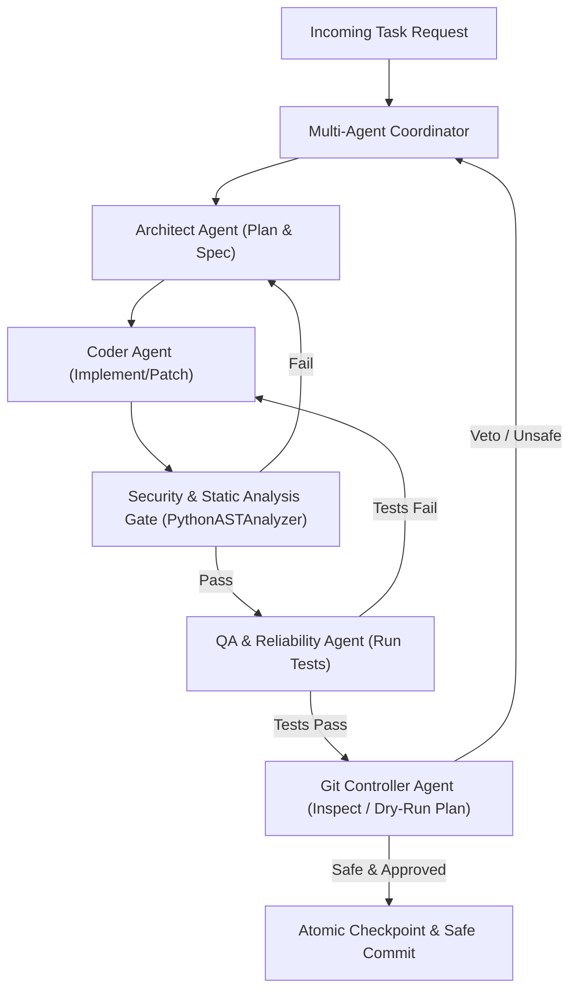

# Kanoman AI — Roadmap & Execution Plan

**Status:** Aktif  
**Versi Roadmap:** 2.0.0 (Disinkronkan Pasca-Tahap 8)  
**Target Delivery:** Fondasi AI Development Orchestrator Siap Produksi & Multi-Agent Engine  
**Workspace:** `C:\kanoman`  
**Repository Resmi:** `https://github.com/qomaruddindjamal/kanoman.git`  
**Branch Kebijakan:** `main`

---

## 1. Definisi Status Milestone

Untuk menjaga transparansi dan auditabilitas, status setiap milestone dan fitur menggunakan taksonomi ketat:
- **`VERIFIED`**: Implementasi fisik dan bukti pengujian otomatis (unit/integration test / CI) tersedia dan 100% lulus.
- **`PARTIAL`**: Implementasi kode telah dimulai tetapi belum seluruh kriteria penerimaan atau pengujian terpenuhi.
- **`NOT IMPLEMENTED`**: Fitur/fase direncanakan secara formal tetapi belum ada implementasi kode di repository.
- **`NOT VERIFIED`**: Kode tersedia namun bukti pengujian atau verifikasi belum memadai.
- **`BLOCKED`**: Pekerjaan terhambat oleh prasyarat fase sebelumnya yang belum terpenuhi atau isu keamanan.

---

## 2. Riwayat & Pelaksanaan Milestone

### FASE 1: Audit Repository & Technical R&D (Status: VERIFIED)
- [x] Verifikasi kondisi lingkungan fisik, Git, Python 3.14, dan GitHub CLI.
- [x] Inisialisasi Git repository lokal bersih dengan remote `origin` (`qomaruddindjamal/kanoman`).
- [x] Inventaris keadaan aktual dan audit matrix (P0–P3) di `docs/audit/INITIAL_AUDIT.md`.
- [x] R&D teknis mendalam terhadap 12 area kunci di `docs/research/RESEARCH_PLAN.md` dan `docs/research/TECHNOLOGY_EVALUATION.md`.
- [x] Matriks evaluasi teknologi 9 kriteria dan pemilihan Pydantic v2 + standard library `urllib` / `ast`.
- [x] Dokumen arsitektur definitif (`docs/ARCHITECTURE.md`) dan keputusan arsitektur awal (`docs/decisions/ADR-0001-initial-architecture.md`).
- **Bukti Verifikasi:** Artefak riset dan arsitektur lengkap pada direktori `docs/`.

---

### FASE 2: Fondasi Kanoman Core (Status: VERIFIED)
- [x] Packaging standar modern `pyproject.toml` dengan build layout `src/kanoman/`.
- [x] Model domain Pydantic v2 (`Task`, `Project`, `Checkpoint`) dengan validasi transisi FSM ketat di `src/kanoman/core/models.py`.
- [x] Configuration Engine dengan Pydantic Settings, masking aman, dan `SecretStr` di `src/kanoman/config/settings.py`.
- [x] Project Registry dengan isolasi workspace root dan pencegahan duplikasi di `src/kanoman/core/registry.py`.
- [x] Task Orchestrator deterministik dengan logging terstruktur dan tersanitasi di `src/kanoman/core/orchestrator.py`.
- [x] Recovery Engine dengan atomic write JSON snapshot di `src/kanoman/checkpoints/recovery.py`.
- [x] Unit test komprehensif untuk seluruh komponen Core (`tests/test_models.py`, `tests/test_config.py`, `tests/test_registry.py`, `tests/test_orchestrator.py`, `tests/test_recovery.py`).
- **Bukti Verifikasi:** Lulus dalam commit `0e1b697` dan regresi teruji di `pytest`.

---

### FASE 3: Git Controller & Repository Isolation (Status: VERIFIED)
- [x] Modul `GitController` terpusat menggunakan subprocess `shell=False` di `src/kanoman/git/controller.py`.
- [x] 4 mode operasi aman: `inspect`, `dry-run`, `commit`, dan `push`.
- [x] Repository identity verification (root workspace, remote URL yang diizinkan, branch kebijakan `main`).
- [x] Secret scanning otomatis pra-commit pada staged diff (`SECRET_SCAN_PATTERNS`).
- [x] Larangan mutlak flag berbahaya (`--force`, `-f`, `reset --hard`, `--force-with-lease`).
- [x] Test suite isolasi repository menggunakan temporary directory di `tests/test_git_controller.py`.
- **Bukti Verifikasi:** 6 tests lulus di `test_git_controller.py` dan verifikasi commit `0e1b697`.

---

### FASE 4: Integrasi AI Modular (Status: VERIFIED)
- [x] Kontrak antarmuka `BaseAIProvider` Protocol di `src/kanoman/ai/base.py`.
- [x] `MockAIProvider` dengan response synthesizer deterministik untuk pengujian unit & CI 100% offline di `src/kanoman/ai/mock.py`.
- [x] `GeminiAIProvider` berbasis REST ringan via `urllib` tanpa dependensi SDK monolitik di `src/kanoman/ai/gemini.py`.
- [x] `OllamaAIProvider` terisolasi dan opsional untuk model inferensi lokal di `src/kanoman/ai/ollama.py`.
- [x] `AIRouter` dengan penanganan fallback otomatis dan sanitasi token di `src/kanoman/ai/router.py`.
- [x] Test suite AI provider di `tests/test_ai_providers.py` (8 tests lulus).
- **Bukti Verifikasi:** Pengujian offline mandiri dan fallback selektif terverifikasi 100%.

---

### FASE 5: Operasional, CLI, Security, dan CI (Status: VERIFIED)
- [x] Antarmuka CLI interaktif di `src/kanoman/cli/main.py` (`status`, `config`, `project`, `task`, `checkpoint`, `git`, `test`).
- [x] Adapter Model Context Protocol (MCP) di `src/kanoman/mcp/server.py` dengan 4 tool terisolasi (`get_system_status`, `list_registered_projects`, `get_active_config`, `inspect_git_status`).
- [x] GitHub Actions CI workflow (`.github/workflows/ci.yml`) dengan hak akses `permissions: contents: read` dan matriks pengujian Python 3.12 & 3.13.
- [x] Dokumen operasional dan keamanan lengkap (`README.md`, `AGENTS.md`, `GEMINI.md`, `KanomanAgents.md`, `docs/SECURITY.md`, `docs/RECOVERY.md`, `docs/DEVELOPMENT.md`).
- **Bukti Verifikasi:** CLI dan MCP teruji di `tests/test_mcp.py` dan runner CI resmi GitHub Actions.

---

### FASE 6: Validasi End-to-End & Kesiapan Fondasi (Status: VERIFIED)
- [x] E2E integration test mencakup seluruh siklus (`load_config -> task -> mock AI -> checkpoint -> git inspect`) di `tests/test_e2e.py`.
- [x] Failure recovery & edge-case stress test.
- [x] Template onboarding proyek baru (`docs/ONBOARDING.md`).
- [x] Final security scan & diff review.
- [x] Commit dan push terverifikasi ke remote repository Kanoman (`qomaruddindjamal/kanoman`).
- **Bukti Verifikasi:** Laporan kesiapan Fondasi Tahap 1–6 (commit `0e1b697`).

---

### TAHAP 7: Independent Audit & Security Hardening (Status: VERIFIED)
- [x] Audit independen menyeluruh terhadap Git Controller, Recovery Engine, Task FSM, dan AI Router.
- [x] Pengetatan Git Controller: validasi path traversal pada seluruh parameter file, pemblokiran tanpa syarat berkas kredensial (`.env*`, `*.key`, `*.pem`, `*.token`), dan verifikasi URL remote sebelum `safe_push()`.
- [x] Pengetatan Recovery Engine: validasi format `checkpoint_id` dan blokir path traversal pada `load_checkpoint()`.
- [x] Pengetatan Task Orchestrator: pemblokiran eksekusi ulang pada task dengan status terminal (`COMPLETED`, `CANCELLED`).
- [x] Pengetatan AI Layer: migrasi API key Gemini ke HTTP header `x-goog-api-key` (bukan query string URL) dan penambahan metode `generate_structured()`.
- [x] Pengetatan Project Registry: persistensi penyimpanan file atomik (`.kanoman_projects.json`) dan penolakan root drive OS (`C:\`, `/`).
- [x] Test suite pengerasan keamanan di `tests/test_audit_hardening.py` (9 tests lulus).
- **Bukti Verifikasi:** Commit `0f070e8`, GitHub Actions CI Run ID `38066050244` (SUCCESS).

---

### TAHAP 8: CI Verification Gate, Automated Code Analysis & Reliability (Status: VERIFIED)
- [x] Verifikasi aktual GitHub Actions CI untuk commit Tahap 7 (100% lulus di Python 3.12 dan 3.13).
- [x] Python AST Analyzer (`src/kanoman/analysis/python_analyzer.py`):
  - Zero code execution (parsing murni via `ast.parse`).
  - Deteksi pola berisiko: `PY_SYNTAX_ERROR`, `PY_EVAL_EXEC`, `PY_SUBPROCESS_SHELL`, `PY_INSECURE_PICKLE`, `PY_HARDCODED_SECRET`, `PY_FILE_READ_ERROR`.
  - Penegakan isolasi path traversal dalam batasan `workspace_root`.
- [x] Markdown Validator (`src/kanoman/analysis/markdown_validator.py`):
  - Validasi sintaksis dan integritas dokumen berbasis state machine baris-demi-baris.
  - Aturan deteksi: `MD_EMPTY_FILE`, `MD_EMPTY_HEADING`, `MD_UNCLOSED_FENCE`, `MD_BROKEN_LINK`, `MD_MALFORMED_CHECKLIST`, `MD_MISSING_LOCAL_REF`, `MD_FILE_READ_ERROR`.
- [x] Model data analisis Pydantic v2 di `src/kanoman/analysis/models.py`.
- [x] Integrasi Task Orchestrator: handler `analyze_python` dan `validate_markdown` dengan penyimpanan hasil ke checkpoint.
- [x] Integrasi CLI: subperintah `kanoman analyze python` dan `kanoman analyze markdown` dengan opsi `--root` dan `--format text|json`.
- [x] Dokumentasi aturan analisis di `docs/ANALYSIS.md` dan rilis versi `0.1.2` di `pyproject.toml` & `CHANGELOG.md`.
- [x] Test suite analisis di `tests/test_analysis.py` (21 tests baru, total test suite meningkat menjadi 67 tests).
- **Bukti Verifikasi:** Commit `636e127`, GitHub Actions CI Run ID `38067754894` (SUCCESS).

---

## 3. Spesifikasi Arsitektur & Perencanaan Tahap 9

### TAHAP 9: Multi-Agent Orchestration & Protocol Expansion (Status: VERIFIED LOKAL — CI REMOTE PENDING PUSH)

**Tujuan:** Membangun lapisan koordinasi multi-agent otonom yang membagi tanggung jawab pengembangan ke persona agen spesialis berbasis hierarki yang deterministik, aman, dan dapat diaudit secara penuh.

#### Ruang Lingkup & Kebutuhan Desain Teknis Minimal:

1. **Model Domain Multi-Agent (`src/kanoman/agents/models.py`):**
   - `AgentRole`: Enum peran (`ARCHITECT`, `CODER`, `SECURITY_AUDITOR`, `QA_ENGINEER`).
   - `AgentMessage`: Kontrak pesan antar-agen tervalidasi dengan provenance ID, timestamp UTC, dan payload pesan tersanitasi.
   - `AgentDecision`: Rekam jejak keputusan spesifik dari agen (alasan, aksi yang diajukan, status persetujuan/penolakan).
   - `AgentPlan`: Rencana kerja multi-tahap yang didelegasikan oleh agen Architect.

2. **Orkestrasi Terpusat & Anti-Bypass Lifecycle:**
   - Seluruh delegasi wajib melewati `MultiAgentCoordinator` / `TaskOrchestrator`.
   - Agen individual **dilarang keras** memodifikasi status task inti (`COMPLETED`, `FAILED`, dll.) secara sepihak di luar FSM `TaskOrchestrator`.
   - Status akhir task hanya dapat disahkan setelah seluruh gerbang peran selesai dan diverifikasi.

3. **Kontrak Input/Output & Audit Provenance:**
   - Setiap pesan dan proposal perubahan harus memiliki asal-usul (*provenance tracking*) yang jelas (agen pengirim, task ID, referensi checkpoint pendukung).
   - Validasi skema input/output menggunakan Pydantic v2 untuk mencegah pesan malformed.

4. **Pembatasan Batas Operasional & Anti-Looping (Safety Barriers):**
   - **Max Iterations:** Batas keras maksimum siklus delegasi (misal maksimal 5 iterasi revisi antar Architect-Coder-QA).
   - **Timeout Per Turn:** Batas waktu eksekusi tiap turn agen untuk mencegah blocking tak terbatas.
   - **Token & Call Budget:** Batas kuota kumulatif pemanggilan AI model per task untuk mencegah lonjakan biaya/eksploitasi kuota.
   - **Cycle Detection:** Deteksi loop delegasi berulang (misal bolak-balik antara Coder dan QA pada error yang sama tanpa kemajuan).

5. **Penanganan Kegagalan, Retry, dan Pemulihan Checkpoint:**
   - Mekanisme retry terbatas dengan penundaan eksponensial untuk kegagalan transien AI provider.
   - Jika batas iterasi atau kegagalan tercapai, koordinasi dibatalkan secara bersih (*fail-closed*), status ditandai `FAILED`, dan state dapat dipulihkan dari checkpoint terakhir yang valid via `RecoveryEngine`.

6. **Pemisahan Konteks & Prinsip Hak Akses Terendah (Least Privilege per Role):**
   - Architect hanya memiliki akses baca ke spesifikasi dan struktur repositori; tidak dapat mengajukan commit.
   - Coder hanya memiliki akses menyusun patch kode di memori/workspace target.
   - QA hanya memiliki izin menjalankan test runner (`python -m pytest`).
   - Security / Git Controller memegang hak eksklusif untuk menyetujui staging dan commit.

7. **Sanitasi Komunikasi & Pencegahan Kebocoran Secret:**
   - Seluruh pesan antargen wajib melalui fungsi sanitasi `redact_sensitive_text()` sebelum dicatat di log atau diteruskan ke prompt agen lain.
   - Tidak ada token autentikasi atau variabel rahasia yang boleh berada dalam payload komunikasi.

8. **Integrasi Static Analysis sebagai Quality Gate (Bukan Sandbox):**
   - Kode yang diusulkan oleh Coder Agent wajib diperiksa secara otomatis melalui `PythonASTAnalyzer` dan `MarkdownValidator` sebelum diserahkan ke QA.
   - **Peringatan Batas Keamanan:** Analisis statis AST berfungsi mendeteksi pola sintaksis berbahaya (`eval`, `exec`, `shell=True`, `pickle`) dan **bukan merupakan runtime execution sandbox**. Kode tidak tepercaya dari luar tetap tidak boleh dieksekusi secara sembarangan.

9. **Git Security & Repository Isolation Lock:**
   - Seluruh operasi Git tetap wajib melewati `GitController`. Agen dilarang mengeksekusi perintah git mandiri via `subprocess`.
   - Git Controller Agent mempertahankan hak veto mutlak: jika dry-run mendeteksi ancaman keamanan, force push, atau modifikasi di luar repositori yang diizinkan (`qomaruddindjamal/kanoman`), commit dibatalkan seketika.

10. **Mock Multi-Agent Baseline untuk Pengujian Deterministik:**
    - Implementasi `MockAgentProvider` yang menyimulasikan respon agen secara deterministik tanpa panggilan internet, memungkinkan 100% test coverage di lingkungan CI lokal dan GitHub Actions.

11. **Rencana Pengujian Komprehensif Tahap 9:**
    - Uji alur delegasi standar (`Architect -> Coder -> QA -> Git Controller`).
    - Uji penolakan veto oleh Git Controller ketika kode berbahaya diajukan.
    - Uji deteksi siklus loop tak terbatas (*cycle detection*).
    - Uji batas maksimum iterasi dan anggaran token.
    - Uji isolasi repositori dan penolakan operasi ke path luar.
    - Uji resume task dari checkpoint multi-agent setelah pembatalan.

12. **Subfase & Gerbang Penerimaan Tahap 9:**
    - [x] **Subfase 9.1:** Domain models multi-agent & skema pesan (`AgentRole`, `AgentMessage`, `AgentDecision`) di `src/kanoman/agents/models.py`.
    - [x] **Subfase 9.2:** Coordinator & FSM alur kerja multi-agent dengan deteksi looping & batasan iterasi di `src/kanoman/agents/coordinator.py`.
    - [x] **Subfase 9.3:** Integrasi Quality Gate (`PythonASTAnalyzer`) dan Hak Veto `GitController` di `src/kanoman/agents/quality_gate.py`.
    - [x] **Subfase 9.4:** Specialist runners (`Architect`, `Coder`, `SecurityAuditor`, `QAEngineer`) & workflow deterministik end-to-end di `src/kanoman/agents/runners.py`.
    - [x] **Subfase 9.5:** Antarmuka CLI `kanoman agent coordinate`, Task Orchestrator handler, dan eksposur tool MCP di `src/kanoman/mcp/server.py`.
    - [ ] **Subfase 9.6:** Validasi GitHub Actions CI (matrix Python 3.12 & 3.13 hijau) — *Status: PENDING PUSH / CI NOT VERIFIED*.
    - **Bukti Verifikasi:** 169 unit & integration tests lulus 100% luring (Pytest 9.1.1, Python 3.14.7), AST Analyzer 0 temuan (34 file), Markdown Validator 0 temuan.

---

## 4. Rencana Jangka Panjang Pasca-Tahap 9

### TAHAP 10: External Project Onboarding & Application Integration (Status: NOT IMPLEMENTED — BLOCKED ON TAHAP 9)

**Prasyarat Wajib:** Tahap 9 Multi-Agent Orchestrator wajib diselesaikan, diuji secara menyeluruh, dan disahkan oleh audit independen sebelum Tahap 10 dimulai.

**Lingkup Kerja:**
- Onboarding repositori aplikasi target eksternal (termasuk **MitraNet**) melalui `ProjectRegistry`.
- Penegakan isolasi repositori ketat per proyek: setiap proyek memiliki workspace root, allowed remote, dan kebijakan branch independen.
- Pengujian interaksi multi-agent Kanoman dalam mengelola, menganalisis, dan memperbaiki kode pada proyek eksternal tanpa risiko mutasi silang repositori.
- Pelaporan kesiapan produksi akhir.

---

## 5. Ringkasan Kriteria Penerimaan Seluruh Fase

Setiap fase wajib melalui tahapan:
1. Audit kondisi awal dan pembuktian ketiadaan regresi.
2. Desain modular yang selaras dengan Hexagonal Architecture.
3. Implementasi berbasis bukti dengan pengetikan ketat Pydantic v2.
4. Pengujian otomatis lokal (`python -m pytest -v`) 100% lulus.
5. Verifikasi Git dry-run dan pemindaian secret tanpa temuan.
6. Commit & Push melalui `GitController` ke branch `main`.
7. Verifikasi hasil workflow CI di GitHub Actions sebelum melanjutkan ke fase berikutnya.
